

<!-- 01 // SWISS-EDITORIAL HERO BENTO -->
<picture>
  <source media="(max-width: 600px)" srcset="assets/hero-bento-mobile.svg">
  
</picture>

<!-- 02 // IDENTITY & EXPERIENCE -->
<picture>
  <source media="(max-width: 600px)" srcset="assets/about-bento-mobile.svg">
  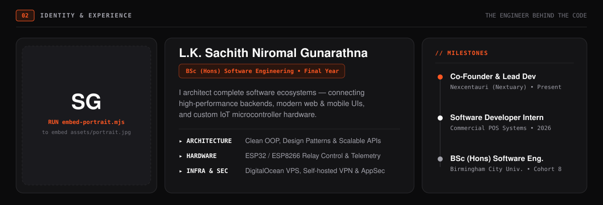
</picture>

<!-- 03 // SELECTED SYSTEMS & ARCHITECTURES -->
<picture>
  <source media="(max-width: 600px)" srcset="assets/projects-bento-mobile.svg">
  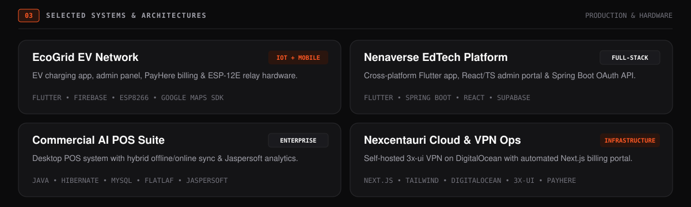
</picture>

<!-- 04 // GITHUB TELEMETRY (AUTO-UPDATED) -->
<picture>
  <source media="(max-width: 600px)" srcset="assets/github-overview-mobile.svg">
  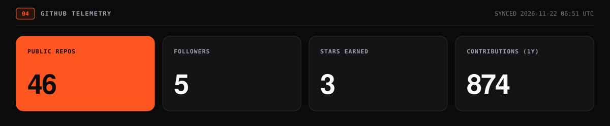
</picture>

<!-- 05 // CODEBASE DISTRIBUTION (AUTO-UPDATED) -->
<picture>
  <source media="(max-width: 600px)" srcset="assets/languages-mobile.svg">
  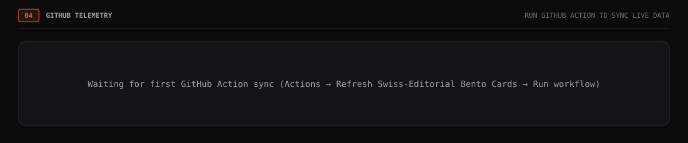
</picture>

<!-- 06 // CONTRIBUTION CONSISTENCY (AUTO-UPDATED) -->
<picture>
  <source media="(max-width: 600px)" srcset="assets/contributions-mobile.svg">
  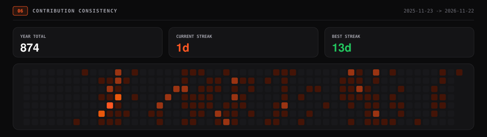
</picture>

 

<!-- ENGINEERING ARSENAL -->

  

  

 

<!-- YOUR LIVE STATUS BAR SYSTEM INTEGRATION -->
<picture>
  <source media="(prefers-color-scheme: dark)" srcset="https://raw.githubusercontent.com/Sachith-Gunarathna/GitHub-status-bar-system/main/assets/dev-signal-dark.svg">
  <source media="(prefers-color-scheme: light)" srcset="https://raw.githubusercontent.com/Sachith-Gunarathna/GitHub-status-bar-system/main/assets/dev-signal-light.svg">
  
</picture>

  

<!-- CLICKABLE BENTO CONNECT BAR -->

  <a href="https://nexcentauri.com" target="_blank">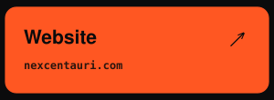</a><a href="https://www.linkedin.com/in/sachith-ng" target="_blank">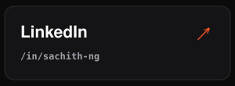</a><a href="mailto:sachithniromal918@gmail.com">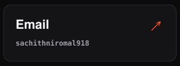</a><a href="https://www.youtube.com/@foxeegaminglk" target="_blank">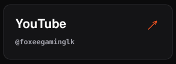</a>

<!-- FOOTER -->
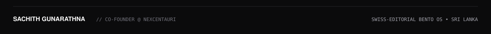

