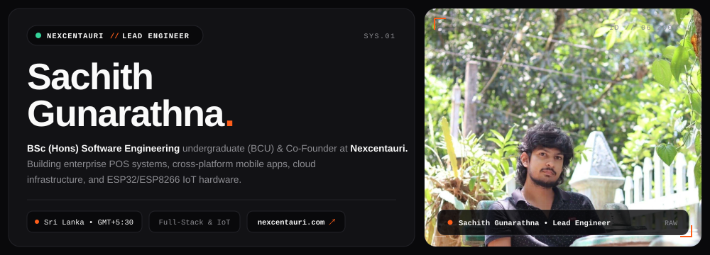
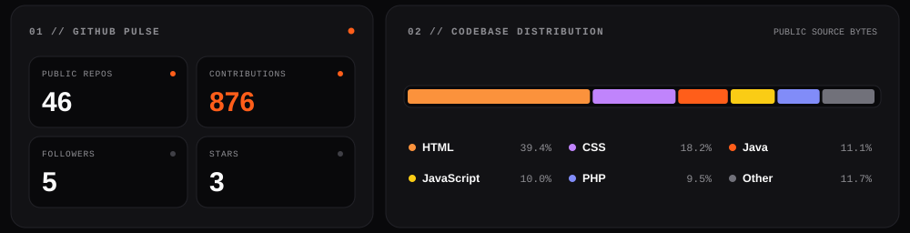
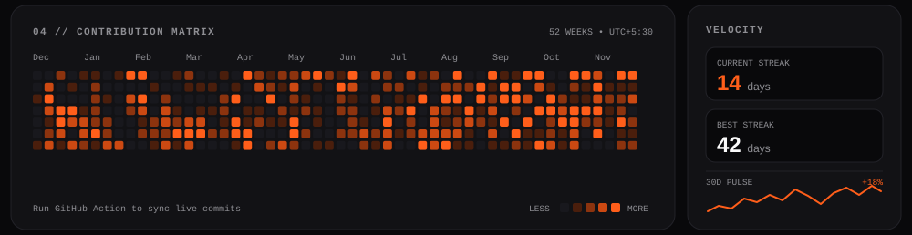
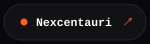
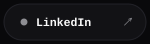
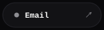
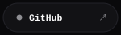
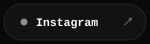
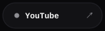

<!-- 1. TOP BENTO CLUSTER (7-COL HERO + 5-COL PORTRAIT) -->

<!-- 2. MIDDLE TELEMETRY ROW (5-COL GITHUB PULSE + 7-COL CODEBASE DISTRIBUTION) -->

<!-- 3. TECH ARSENAL (3-COLUMN ARCHITECTURAL) -->

<!-- 4. CONTRIBUTION MATRIX (9-COL) + VELOCITY PANEL (3-COL) -->

 

<!-- 5. FLOATING CONNECT DOCK -->

  

<!-- 6. MINIMALIST FOOTER -->

