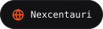
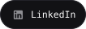
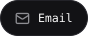
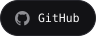
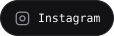
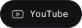
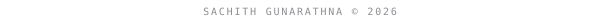

<!-- ASYMMETRIC BENTO OS DASHBOARD (AUTO-UPDATED VIA GITHUB ACTIONS) -->

  

<!-- BOTTOM FLOATING CONNECT DOCK (EVERY BUTTON NATIVELY CLICKABLE) -->

  &nbsp;
  &nbsp;
  &nbsp;
  &nbsp;
  &nbsp;
  

<!-- MINIMALIST FOOTER -->

  

